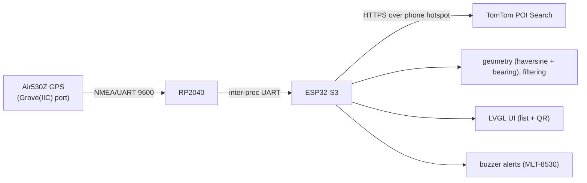

<h1 align="center">Indicator Fuel Finder</h1>
<p align="center"><em>GPS gas-station finder on a SenseCAP Indicator D1L.<br>Shows fuel stations ahead on your route, with QR codes to open them in Maps.</em></p>

<p align="center">
  <a href="docs/STATUS.md"></a>
  <a href="docs/STATUS.md"></a>
  <a href="#data-provider"></a>
  <a href="#how-it-works"></a>
  <a href="#how-it-works"></a>
</p>
<p align="center">
  
  
  
  
  
  
  <a href="LICENSE"></a>
  
</p>

## Overview

A GPS-driven gas-station finder built on a **SenseCAP Indicator D1L**, for a 7-day
Florida road trip. It shows nearby fuel stations that are *ahead* of you, with a
scannable QR code so a passenger can open the exact station in Maps and
cross-reference its price in GasBuddy.

It runs as **separate custom firmware** — the device's Meshtastic firmware is left
untouched and recoverable.

> **Status:** core works end-to-end (GPS → RP2040 → ESP32 → TomTom, verified on
> hardware); the on-screen LVGL UI is the remaining piece. See **[`docs/STATUS.md`](docs/STATUS.md)**
> for the current state and the next-session plan.

## How it works



> The Grove ports are wired to the **RP2040**, so the GPS plugs into `Grove(IIC)`
> and the RP2040 forwards NMEA to the ESP32-S3. No soldering. Details in
> [`docs/hardware/`](docs/hardware/).

1. Parse GPS continuously — position + course-over-ground (NMEA `RMC`).
2. On a **~3 km movement threshold**, query TomTom for nearby fuel stations.
3. Compute **distance** and **bearing** to each station on-device.
4. **Heading filter** — show only stations "ahead" (bearing within ±70° of course),
   applied only above ~15 km/h; below that, fall back to plain radial-nearest.
5. **LVGL list UI** — brand + address + distance + bearing.
6. **Station detail = QR code** encoding `geo:lat,lng`. Scan it → opens the exact
   station in Maps → look up the price in GasBuddy. This is the primary
   disambiguation UX (provider POI IDs do **not** map to GasBuddy's catalog; the
   human join key is brand + full address + coords).
7. **Proximity buzzer** when within range of a target / in low-fuel mode.
8. Optional brand filter (e.g. only certain chains).

The data uplink is outbound-only to TomTom; nothing is exposed inbound.

## Tech stack

| Layer | Choice |
|---|---|
| Device | SenseCAP Indicator D1L (ESP32-S3 + RP2040) |
| GPS | Air530Z Grove GPS module |
| Firmware | PlatformIO + Arduino framework, C++ |
| UI | LVGL 8.x (`lv_qrcode`) |
| Data provider | TomTom Search API (Nearby Search) |

<details>
<summary><b>Hardware</b></summary>

**SenseCAP Indicator D1L** (Seeed SKU `114993532`)

- MCUs: ESP32-S3 (≤240 MHz, 8 MB flash) + RP2040 (≤133 MHz, 2 MB flash)
- Display: 3.95" RGB capacitive touch, 480 × 480
- Radios: SX1262 LoRa, Wi-Fi 2.4 GHz, BLE 5.0
- Storage: microSD up to 32 GB (not included)
- Buzzer: MLT-8530
- Power: USB-C, 5 V / 1 A
- **Not onboard:** GPS, battery, cellular

**Externals**

- Grove GPS module — provides position + course-over-ground.
- Car USB-C charger — the device lives powered (no internal battery).
- Phone Wi-Fi hotspot (2.4 GHz) — the only uplink while driving.

</details>

<details>
<summary><b>Firmware stack</b></summary>

- **PlatformIO + Arduino framework** (developed in VSCode on Fedora).
- **LVGL 8.x** for the UI (includes `lv_qrcode`).
- Libraries: `TinyGPSPlus` (NMEA parsing), `ArduinoJson` (POI response),
  `WiFiClientSecure` / `HTTPClient` (HTTPS GET).

### Planned `src/` layout

```
src/
  config/      # wifi creds, API key, thresholds, brand filters (git-ignored secrets)
  gps/         # NMEA parse: position + course-over-ground (CoG)
  poi_client/  # IFuelProvider interface + TomTomProvider impl
  geo/         # haversine distance, bearing, heading filter
  ui/          # LVGL list view + station detail w/ QR
  alerts/      # proximity / low-fuel buzzer logic
```

</details>

## Data provider

**TomTom Search API** (Nearby Search) — chosen for the lowest onboarding friction:
no credit card, a generous free daily tier (2,500 non-tile requests/day), and clean
JSON. Expected usage stays well inside the free tier → **$0** for the trip.

All provider access goes through an `IFuelProvider` interface with a single core
method, e.g. `getNearby(lat, lng) -> [Station]`, where
`Station = { brand, address, lat, lng, providerId, distance, bearing }`. This keeps
**Google Places** and **OSM Overpass** swappable without touching the rest of the
firmware.

See **[`TOMTOM_SEARCH_API.md`](TOMTOM_SEARCH_API.md)** for the full integration
reference (endpoint, params, response fields, cost notes).

## Getting started

Build and flash steps for both firmwares are in [`firmware/README.md`](firmware/README.md).

### Configuration & secrets

Secrets — Wi-Fi credentials and the TomTom API key — live in `config/` and are
**git-ignored**. Never commit keys.

The TomTom key is embedded in ESP32 flash (extractable), so scope it to **Search API
only** and set a spend cap. Pass it as `TOMTOM_API_KEY`; inject at build/runtime.

## Project notes

<details>
<summary><b>Out of scope for v1</b></summary>

- **Fuel prices on-device** — TomTom Fuel Prices is enterprise/contact-sales, and
  cheap APIs only return regional averages. Price lookup stays a manual passenger
  workflow via GasBuddy (the QR makes it trivial).
- **MQTT / home-infra integration** — no runtime dependency on home infra.
- **Route-following / search-along-route** — needs a routing API + fixed
  destination; deferred. v1 = radial + heading filter (~90% of the value at zero
  extra API cost).
- **Modifying the Meshtastic firmware partition** — must remain intact and
  recoverable.

</details>

<details>
<summary><b>Pending verification</b></summary>

Open questions to resolve before/while scaffolding:

1. ~~**Grove port wiring (key unknown)**~~ — **Resolved:** both Grove ports are on
   the **RP2040** → two firmwares (ESP32-S3 app + RP2040 GPS reader). See
   [`docs/hardware/grove-ports.md`](docs/hardware/grove-ports.md).
2. ~~**Grove GPS UART details**~~ — **Resolved:** Air530Z = UART/NMEA @ 9600, RMC
   present; lands on RP2040 UART1 (GPIO20/21) via `Grove(IIC)`, no crossover. See
   [`docs/hardware/gps-air530z-wiring.md`](docs/hardware/gps-air530z-wiring.md).
3. **TomTom request shape** — confirm the fuel `categorySet` (likely `7311`), field
   mask / address fields, result limit, radius. *(Largely resolved in
   [`TOMTOM_SEARCH_API.md`](TOMTOM_SEARCH_API.md).)*
4. **Display driver config** — RGB panel controller + pin map under PlatformIO Arduino.
5. **LVGL version pin** — lock the major version and confirm `lv_qrcode` availability.
6. **Phone hotspot band** — confirm 2.4 GHz (device has no 5 GHz radio).
7. **TomTom pricing change effective 2026-07-01** — re-check terms if this becomes
   permanent.

</details>

<details>
<summary><b>Phase 2+ (post-trip, optional)</b></summary>

- MQTT telemetry breadcrumb → HiveMQ → Grafana dashboard.
- Regional average price overlay (clearly labeled as average, not per-pump).
- "Last station before a long gap" alert using remaining range.
- True search-along-route once a destination/route is in play.

</details>

<details>
<summary><b>Conventions</b></summary>

- **English** for all code, comments, commits, and docs.
- Secrets in `config/`, git-ignored — never commit keys.
- Dev environment: PlatformIO in VSCode on Fedora.

For full project context and the decision log (the "why"), see
**[`CLAUDE.md`](CLAUDE.md)**.

</details>

## License

MIT — see [LICENSE](LICENSE).

---

<p align="center">
  Built by <b>Jose Cedeno</b> ·
  <a href="https://geekendzone.com">geekendzone.com</a> ·
  <a href="https://www.linkedin.com/in/joseangelcedeno/">LinkedIn</a>
</p>
